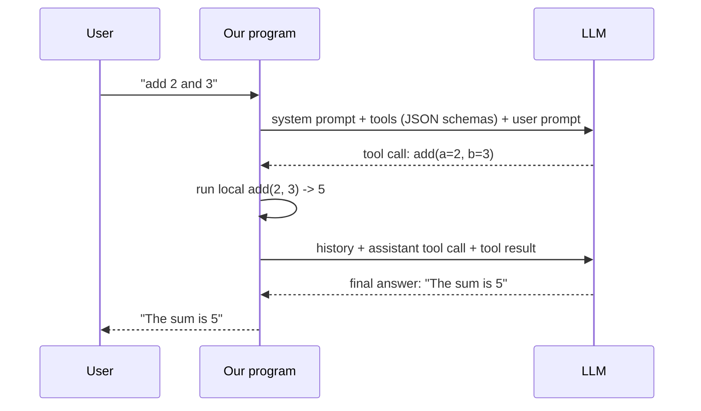

# LLM ↔ Function Call Flow

## Goal

Make the LLM **ask** our program to do the work (calculations, data lookups, side effects) instead of doing it itself. We control this with the **system prompt**, which instructs the model to use the available functions rather than answer directly.

## Setup

1. Create a Python function that performs the work.
2. Create a **JSON schema** (tool definition) that describes the function:
   - The **method description is critical** — it binds the prompt's instructions to the function and tells the LLM *when* to use it.
   - Pass this JSON to the API to make the function available to the model.
   - Repeat for **every** function the model should be able to call.

## Flow

1. The user prompt asks the LLM to "do" something (e.g., add two numbers).
2. The LLM matches the user's intent to a tool and returns the **tool name + parameters** as a tool call — not the final answer.
3. The program checks the assistant message: does it have plain `content`, or a **tool call**?
   - **If it is a tool call:**
     1. Append the assistant message (including `tool_calls`) to the message history.
     2. Invoke the local function with the parsed parameters.
     3. Create a tool response message containing the result and the matching `tool_call_id`.
     4. Append the response message and send the full history back to the LLM.
4. The LLM now creates the **final reply** for the user.

The above is known as the **ReAct Pattern** in agentic AI.
