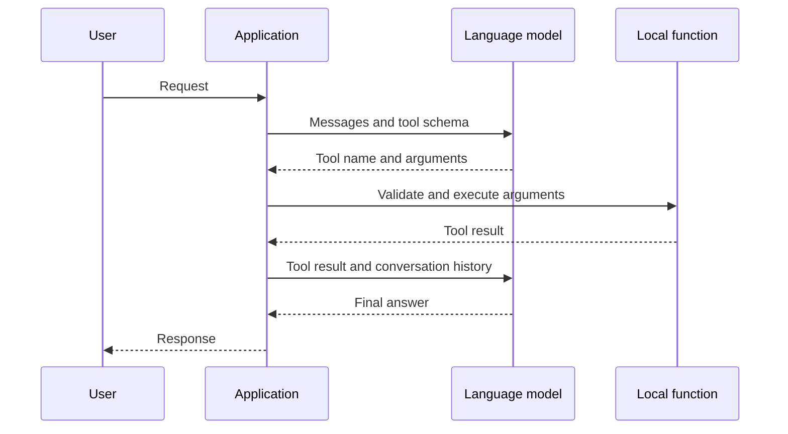

# Week 1: LLM Basics — Questions and Answers

This week introduces model endpoints, tokenization, prompting, chat-completion APIs, function calling, and MLflow tracing.

## Technical Questions

1. **How do you load Databricks credentials and configure an OpenAI-compatible client?**  
   Load `DATABRICKS_TOKEN`, `DATABRICKS_HOST`, and `DATABRICKS_MODEL` from the environment, then initialize `OpenAI(api_key=token, base_url=f"{host}/serving-endpoints")`.

2. **How can you list serving endpoints through the Databricks REST API?**  
   Send a GET request to `{DATABRICKS_HOST}/api/2.0/serving-endpoints` with `Authorization: Bearer {DATABRICKS_TOKEN}`, then read endpoint names from the JSON response.

3. **How do you compare tokenization using two encodings?**  
   Get each encoding with `tiktoken.get_encoding(name)`, call `.encode(text)`, and compare the resulting token IDs and their counts.

4. **How do you encode and decode a string with `tiktoken`?**  
   Call `ids = encoding.encode(text)` and then `encoding.decode(ids)`; compare the decoded string to the original to check the round trip.

5. **How do you report token usage from a chat-completion response?**  
   Read `response.model` and `response.usage.prompt_tokens`, `.completion_tokens`, and `.total_tokens`.

6. **How would you implement zero-shot and few-shot sentiment classification?**  
   For zero-shot, give the task and label choices. For few-shot, add representative labeled reviews before the review to classify.

7. **How do you create a two-step prompt chain for review sentiment?**  
   First ask the model to extract positive and negative signals; pass that result to a second prompt that assigns a label and brief explanation.

8. **How is conversation context maintained across API calls?**  
   Append each user message and the assistant response to the message list, then send that history with the next request.

9. **How do you stream a chat-completion response?**  
   Set `stream=True`, iterate over chunks, and print each non-empty `chunk.choices[0].delta.content`.

10. **How can you compare temperature settings fairly?**  
    Send the same prompt and other parameters with each temperature, then compare the responses; `max_tokens` can keep their maximum length consistent.

11. **How can a model return JSON that Python can consume?**  
    Request JSON-only output (or a supported JSON response format), then parse the response string with `json.loads`.

12. **What must a function-tool schema specify for an integer-adder?**  
    Its name, description, object parameters `a` and `b` with integer types, and both parameter names in `required`.

13. **What is the application’s function-calling sequence?**  
    Parse the assistant’s tool-call arguments, invoke the local function, append a tool message with the matching `tool_call_id`, and ask the model to produce its final response.

14. **How can a tool schema be generated from a Python function?**  
    Inspect its signature and type hints to derive parameter types and required fields; use its name and docstring as the tool name and description.

15. **How can MLflow trace a chat-completion call and record its usage?**  
    Decorate the request function with `@mlflow.trace`, then log run parameters, token metrics, prompt and response text, and trace identifiers.

## Conceptual Questions

1. **What is a token?**  
   A token is a model-specific unit of text, such as a word, part of a word, punctuation, or whitespace.

2. **Why can two encodings tokenize the same text differently?**  
   Encodings use different vocabularies and segmentation rules, so token boundaries and counts can differ.

3. **Why does tokenization matter for context limits and cost?**  
   Models consume tokens rather than characters; token counts affect how much input fits and, for metered APIs, how much a request costs.

4. **Why may code, JSON, URLs, numbers, whitespace, and emoji use tokens differently from prose?**  
   Their character patterns may match the tokenizer’s vocabulary less efficiently, producing different token-to-character ratios.

5. **How do estimated token counts differ from API-reported usage?**  
   A local estimate depends on the chosen encoding and may omit message overhead; response usage reports the service’s counted tokens for that call.

6. **What do the `system`, `user`, and `assistant` roles represent?**  
   `system` supplies instructions, `user` supplies input, and `assistant` represents the model’s conversational turns.

7. **What does a system prompt do when it conflicts with a user request?**  
   It establishes higher-priority behavior, which the model is generally expected to follow over conflicting user instructions.

8. **Why include prior messages in a multi-turn request, and what is the tradeoff?**  
   The model has no automatic access to earlier API calls, so history supplies context; longer histories consume more tokens and context space.

9. **When is few-shot prompting useful compared with zero-shot prompting?**  
   Examples can clarify the desired labels, format, or task pattern when the model’s output needs more guidance.

10. **What is prompt chaining, and what is a key risk?**  
    Prompt chaining passes one step’s output into another; a mistake in an intermediate output can propagate into the final result.

11. **Why request a strict response format?**  
    Structured output is easier for an application to parse and use than unconstrained prose, though it should still be validated.

12. **What does streaming change for an application?**  
    It allows output to be displayed as it arrives instead of waiting for the entire response.

13. **How do `temperature`, `top_p`, `max_tokens`, and `n` differ?**  
    Temperature and `top_p` affect sampling diversity, `max_tokens` caps output length, and `n` requests multiple completions.

14. **What does the model do in function calling, and what does the application do?**  
    The model selects a tool and proposes arguments; the application validates and executes the function, then sends its result back.

15. **What are MLflow traces and spans useful for?**  
    A trace records a full operation and spans capture its component steps; together with logged inputs, outputs, and metrics they help inspect behavior and diagnose failures.

## Function-Calling Flow

