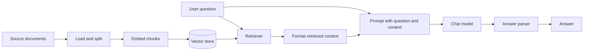

# Week 2: LangChain — Questions and Answers

This week covers LangChain model calls, prompt templates, Runnable/LCEL composition, embeddings, vector stores, retrieval-augmented generation (RAG), and record-manager indexing.

## Technical Questions

1. **How do you call a chat model through LangChain?**  
   Configure a `ChatOpenAI` instance for the Databricks endpoint and call `llm.invoke(input)`.

2. **How do you turn a prompt, model, and text parser into a chain?**  
   Compose them with LCEL: `prompt | llm | StrOutputParser()`, then call `chain.invoke(values)`.

3. **How do you define a prompt template with an input variable?**  
   Use `PromptTemplate` or `ChatPromptTemplate` with placeholders, then invoke it with a dictionary containing those variable names.

4. **What is a partial prompt template useful for?**  
   It pre-fills values that stay fixed, leaving only the remaining variables to be provided for each invocation.

5. **How do you run a Runnable over multiple inputs?**  
   Call `.batch(list_of_inputs)` to process a collection of inputs through the same pipeline.

6. **How does `RunnablePassthrough.assign` enrich an input?**  
   It preserves the input dictionary and adds or replaces fields computed from that input.

7. **How do you wrap a Python transformation as a Runnable?**  
   Use `RunnableLambda(function)`; it can then be composed with other Runnables.

8. **How do you generate document embeddings and store them in PGVector?**  
   Configure an embedding model and call `PGVector.from_documents(documents, embedding=embeddings, ...)` or an equivalent constructor.

9. **How do you prepare a long text file for vector indexing?**  
   Load it into `Document` objects, split it (for example with `RecursiveCharacterTextSplitter`), and retain useful metadata on the chunks.

10. **How do you retrieve the top relevant documents from a vector store?**  
    Convert it to a retriever with `as_retriever(search_kwargs={"k": number})` and call `retriever.invoke(query)`.

11. **What does a typical RAG chain pass to the model?**  
    It retrieves documents, formats their page content as context, combines that context with the original question, and invokes the prompt/model/parser chain.

12. **How can one chain preserve the question while retrieving context?**  
    Use a mapping such as `{"question": RunnablePassthrough(), "context": retriever | RunnableLambda(format_docs)}` before the prompt.

13. **What is the role of document metadata in RAG?**  
    Metadata records provenance or attributes (such as source or page number) and can support filtering, display, and source attribution.

14. **How does the LangChain `index` utility use a record manager?**  
    The record manager tracks source/document IDs while `index()` embeds and indexes records and applies a selected cleanup policy.

15. **How do the record-manager cleanup modes differ?**  
    No cleanup leaves stale records, incremental cleanup removes stale records for sources updated in the run, and full cleanup removes records not present in the complete indexing input.

## Conceptual Questions

1. **What does LangChain add around a model API?**  
   It provides reusable components and interfaces for composing prompts, models, parsers, retrievers, and application logic.

2. **What is a Runnable?**  
   It is a component that follows a common execution interface, enabling steps to be composed and invoked consistently.

3. **What does LCEL’s pipe operator express?**  
   It connects components so that each step’s output becomes the next step’s input.

4. **Why use prompt templates instead of constructing strings manually?**  
   Templates make variable inputs explicit and let prompts be reused with consistent structure.

5. **How do `invoke` and `batch` differ?**  
   `invoke` processes one input; `batch` processes multiple inputs through the same Runnable.

6. **What is an embedding?**  
   An embedding is a numerical vector representation of content that can be compared for semantic similarity.

7. **How is vector similarity used in retrieval?**  
   The query and document chunks are embedded, then the store returns chunks whose vectors are close to the query vector.

8. **Why split documents into chunks before embedding?**  
   Smaller, focused chunks can be retrieved with more relevant context and fit more practically into model prompts.

9. **What is the purpose of chunk overlap?**  
   Overlap preserves context that might otherwise be split across neighboring chunk boundaries.

10. **What are the core stages of a RAG pipeline?**  
    Load documents, split them, embed and index chunks, retrieve relevant chunks for a question, and generate an answer grounded in them.

11. **How does RAG differ from asking a model from memory alone?**  
    RAG supplies retrieved external context at request time instead of relying only on information encoded during model training.

12. **Why format retrieved documents before including them in a prompt?**  
    Formatting converts document objects into readable context while preserving the original question and any useful source information.

13. **What is a retriever’s responsibility?**  
    It accepts a query and returns relevant documents; it does not itself generate the final natural-language answer.

14. **Why use a record manager when indexing repeatedly?**  
    It tracks indexed records and sources so updates can avoid duplicates and remove stale chunks according to the chosen cleanup policy.

15. **What tradeoff should be considered when choosing full versus incremental cleanup?**  
    Full cleanup assumes the run represents the whole corpus; incremental cleanup is safer for partial source updates but requires reliable source grouping.

## LangChain RAG Flow

