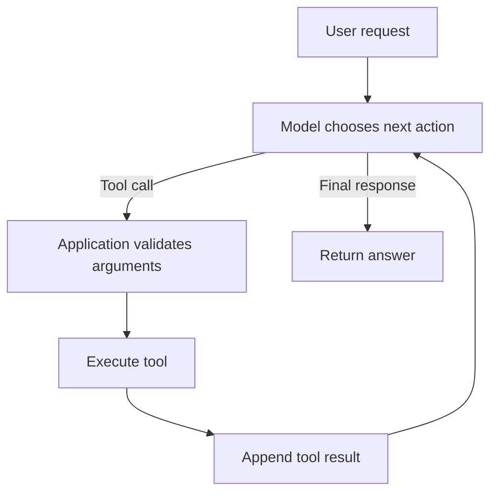

# Week 3: Tool-Using Agents — Questions and Answers

This week develops LangChain agents with tools, structured inputs, web search, memory, runtime context, streaming, and tool-error handling.

## Technical Questions

1. **How is a Python function exposed as a LangChain tool?**  
   Decorate the function with `@tool`, give it a clear docstring, and provide type hints for its arguments.

2. **How do you make a model aware of a tool?**  
   Bind the tool to the model (for example, `llm.bind_tools([tool])`) or pass it to `create_agent`.

3. **How do you invoke a simple tool directly?**  
   Call `tool.invoke` with an input matching its schema, such as `{"a": 2, "b": 3}`.

4. **How does an agent use a calculator tool to answer a question?**  
   Give the agent the calculator tools and a question; the agent selects a tool, runs it, and uses the result to formulate a response.

5. **How can you provide web search to an agent?**  
   Implement or configure a search tool, describe its query input and results, and include it among the agent’s available tools.

6. **How do you create an agent with tools and invoke it?**  
   Construct it with a model and tool list, then pass a message payload such as `{"messages": [HumanMessage(content=question)]}` to `.invoke`.

7. **How can you give an agent structured tool arguments with Pydantic?**  
   Define a `BaseModel` with typed fields and `Field` descriptions, then use that model as the tool’s argument schema.

8. **How do you preserve agent conversation memory between turns?**  
   Attach a checkpointer and invoke successive turns using the same configurable `thread_id`.

9. **How can runtime context customize an agent call?**  
   Pass context through the runtime configuration and declare a context schema; tools can read the relevant values from `RunnableConfig`.

10. **How does `configurable` differ from `context` in a runtime configuration?**  
    `configurable` carries per-run settings such as identifiers or switchable parameters; typed runtime context carries application context intended for the run.

11. **How do you stream an agent’s response?**  
    Iterate over `agent.stream(...)`, selecting a mode such as `updates`, `values`, or `messages` depending on what the interface needs.

12. **What does `stream_mode="messages"` provide?**  
    It yields model message chunks, allowing the application to display generated text incrementally.

13. **How can a tool report a recoverable, expected failure?**  
    Return a clear error result or raise `ToolException` when configured middleware can handle it; do not disguise failures as successful results.

14. **How can you add an agent-specific system prompt?**  
    Supply a `SystemMessage` in the input or configure the agent with a system prompt/state modifier.

15. **How do you request structured output from a tool-using agent?**  
    Describe the desired schema explicitly, or use a structured-output mechanism supported by the model/agent and validate the returned data.

## Conceptual Questions

1. **What makes an LLM application an agent rather than a single model call?**  
   An agent can choose and use tools in a loop, incorporating tool results before deciding what to do next.

2. **What is the difference between a tool and an agent?**  
   A tool performs a defined operation; an agent uses a model to decide whether and how to call available tools.

3. **Why should a tool have a clear name, description, and schema?**  
   Those details help the model choose the right tool and provide arguments in the expected shape.

4. **What role does the application play in a tool call?**  
   It validates and executes the requested operation, then returns the result to the model; the model does not execute local code itself.

5. **Why use Pydantic for structured tool inputs?**  
   It makes fields, types, descriptions, defaults, and validation rules explicit.

6. **Why might a calculator tool be preferable to asking a model to do arithmetic mentally?**  
   A calculator performs deterministic computation and can reduce arithmetic mistakes.

7. **Why provide web search to an agent?**  
   It enables retrieval of current or external information that may not be available in the model’s learned knowledge.

8. **What is the difference between per-call input and persistent conversation memory?**  
   Per-call input applies to one invocation; persistent memory uses saved state (typically keyed by thread) to carry context across invocations.

9. **What does a `thread_id` accomplish when using a checkpointer?**  
   It identifies which conversation state should be resumed or updated.

10. **Why keep user-specific runtime context separate from conversation messages?**  
    It gives tools controlled access to application data without needing to expose that data as ordinary conversational text.

11. **What is the benefit of streaming an agent rather than waiting for its final state?**  
    Streaming gives earlier feedback and can expose intermediate progress or text to the user.

12. **How do `values`, `updates`, and `messages` streaming modes differ?**  
    `values` emits the full state, `updates` emits state changes, and `messages` emits model message chunks.

13. **Why must tool failures be handled explicitly?**  
    Clear failure signals let the agent or application recover appropriately and avoid presenting an invalid result as success.

14. **What should a system prompt establish for an agent?**  
    It should define the agent’s role, constraints, response style, and relevant tool-use expectations.

15. **Why validate structured output even when a model was asked to follow a schema?**  
    Model output can still be incomplete or malformed, so application-side validation protects downstream code.

## Agent Tool Cycle

