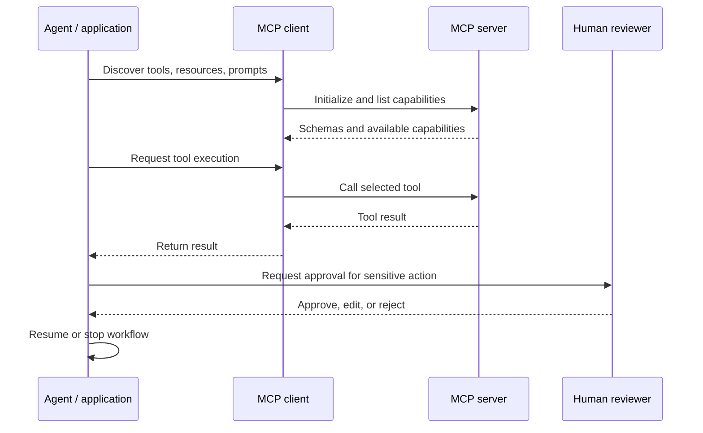

# Week 4: Multi-Agent Systems, MCP, and Middleware — Questions and Answers

This week explores agent coordination, the Model Context Protocol (MCP), async execution, and middleware for human approval, guardrails, reliability, and context management.

## Technical Questions

1. **How can one LangChain agent delegate work to a specialized agent?**  
   Wrap the specialist’s invocation in a typed `@tool` function and give that tool to the coordinating agent.

2. **How does a supervisor route a request to a specialist?**  
   Store the routing decision in graph state and use conditional edges to select the specialist node.

3. **How can specialists share results in a multi-agent workflow?**  
   Define shared state fields for the results and return updates to those fields from each agent or tool.

4. **How can independent specialist work run concurrently in Python?**  
   Use `asyncio.gather` with asynchronous operations; use an `asyncio.Semaphore` to limit concurrent calls.

5. **How do you expose a function as an MCP tool?**  
   Define it on an MCP server with the server’s tool decorator and provide clear inputs and descriptions.

6. **How do MCP resources and prompts differ from tools?**  
   Tools perform actions, resources expose data, and prompts provide reusable prompt templates.

7. **How does a LangChain MCP client discover tools?**  
   Connect to the server with `MultiServerMCPClient`, then call `get_tools()` and inspect the returned tool schemas.

8. **How can an MCP tool be used by a LangChain agent?**  
   Add the discovered MCP tools to the agent’s tool list; the agent can then select and invoke them through its normal tool cycle.

9. **How can an MCP client load a server resource or prompt?**  
   Use the MCP adapter’s resource-loading or prompt-loading functions after connecting to the server.

10. **When is stdio transport useful for MCP, and when is HTTP useful?**  
    Stdio is convenient when a client launches a local server process; streamable HTTP supports communication with a separately hosted server.

11. **How can an agent pause before sending an email or issuing a refund?**  
    Configure human-in-the-loop middleware for the sensitive tool and use a checkpointer so the paused execution can be reviewed and resumed.

12. **How does an approved or edited human decision resume a paused agent?**  
    Reinvoke the agent with the same thread configuration and a `Command` containing the resume decision or edited action.

13. **How can middleware limit message history before a model call?**  
    Use message-trimming or filtering utilities, or a `before_model` hook that returns a reduced message list.

14. **How can middleware make transient model or tool failures more reliable?**  
    Apply retry middleware to retry transient failures and fallback middleware to switch to a backup model when appropriate.

15. **How can custom wrapping middleware intercept model or tool calls?**  
    Implement `wrap_model_call` or `wrap_tool_call` around the handler to measure, log, transform, reject, or short-circuit a call.

## Conceptual Questions

1. **When is a multi-agent design useful?**  
   It can help when a task benefits from distinct specialist roles or when independent parts can be delegated and coordinated.

2. **What is the supervisor pattern?**  
   A coordinator selects which specialist should handle a request and controls how the workflow proceeds.

3. **What is the agent-as-tool pattern?**  
   A specialist agent is presented to another agent as a callable capability, hiding its internal steps behind a clear interface.

4. **Why define shared state explicitly between agents?**  
   Typed, named fields make the information passed between steps predictable and easier to inspect.

5. **When does parallel execution help, and what can constrain it?**  
   It helps when tasks are independent and I/O-bound; dependencies, rate limits, and shared resources may limit safe concurrency.

6. **What is MCP intended to standardize?**  
   It provides a common protocol for clients to discover and use server-provided tools, resources, and prompts.

7. **What is the difference between an MCP server and an MCP client?**  
   The server exposes capabilities; the client connects, discovers them, and requests their use.

8. **Why inspect a tool’s schema before invoking it?**  
   The schema reveals required inputs and types, helping clients or agents construct valid calls.

9. **What is middleware in an agent application?**  
   Middleware intercepts lifecycle stages to add behavior such as logging, validation, retries, or approval without embedding it in every tool.

10. **Why require human approval for some tool calls?**  
    Approval provides a control point before consequential or irreversible actions.

11. **Why does human-in-the-loop execution need persistence?**  
    The application must retain the paused graph state so it can continue the same operation after a human responds.

12. **What is a guardrail, and where might it be applied?**  
    A guardrail enforces an application constraint, such as input validation, PII handling, output checks, or call-count limits.

13. **How do retries differ from fallbacks?**  
    A retry repeats an operation that may succeed later; a fallback switches to a different implementation or model.

14. **Why select only a subset of tools when an agent has many?**  
    Tool selection can reduce irrelevant options and the context required to present them to the model.

15. **Why edit context in a long-running conversation?**  
    Trimming or replacing bulky old tool results can control token usage while keeping the most useful recent context.

## MCP and Human-Approval Flow

