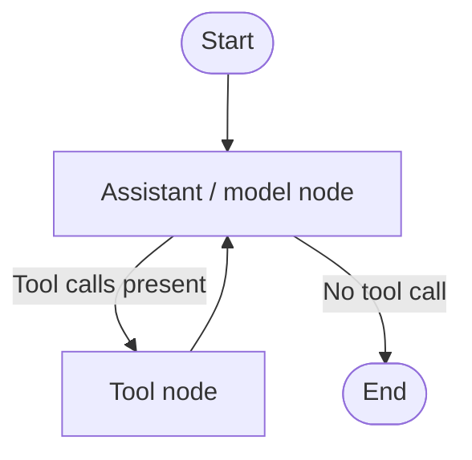
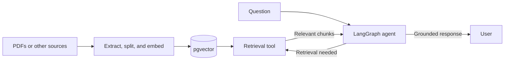

# Week 5: LangGraph — Questions and Answers

This week builds explicit stateful workflows with LangGraph: graph construction, state reducers, tool loops, routing, memory, human approval, subgraphs, streaming, and RAG.

## Technical Questions

1. **How do you create a basic LangGraph workflow?**  
   Define a state schema, create a `StateGraph`, add nodes and edges, then compile it before invoking.

2. **What does a node function receive and return?**  
   It receives the current state and returns a partial state update.

3. **How do you specify a linear workflow from a start node to an end node?**  
   Add nodes, connect them with `add_edge`, and connect the final node to `END`.

4. **How can a graph choose a destination based on state?**  
   Add conditional edges with a routing function that reads state and returns the next node key.

5. **How does a reducer change state-update behavior?**  
   Annotate a state field with a reducer, such as `operator.add`, to combine updates instead of replacing the prior value.

6. **What does the `add_messages` reducer do?**  
   It merges message updates into message state while handling message IDs and supported message-update semantics.

7. **How can you define a graph state that uses standard message handling?**  
   Use LangGraph’s `MessagesState`, or define a message field annotated with `add_messages`.

8. **How do you implement a tool-calling agent loop explicitly?**  
   Add an assistant node, route tool-call responses to a `ToolNode`, then return to the assistant until the response has no tool calls.

9. **What does `tools_condition` help with?**  
   It routes from the assistant according to whether the latest response requests tools or is ready to end.

10. **How do you keep graph state between conversational turns?**  
    Compile with a checkpointer and pass a stable `thread_id` in the invocation’s configurable settings.

11. **How do you pause a graph for human review and resume it?**  
    Interrupt before or during a sensitive action, persist the checkpoint, then resume the same thread with a `Command` carrying the human decision.

12. **When would you add a subgraph as a node versus call it inside a node?**  
    Add it as a node when parent and child can share compatible state; call it inside a node when state conversion or a different schema is needed.

13. **How do LangGraph stream modes differ?**  
    `values` emits full state snapshots, `updates` emits node updates, and `messages` emits model message chunks.

14. **What are the main steps for indexing documents for the Week 5 RAG example?**  
    Convert source PDFs to text/Markdown, split into chunks, embed them, and store the vectors and metadata in pgvector.

15. **How does a LangGraph RAG agent use an existing vector collection?**  
    Define retrieval as a tool, connect it to the agent graph, and let the model decide when to retrieve context before answering.

## Conceptual Questions

1. **Why represent an agent workflow as a graph?**  
   A graph makes state transitions, branches, loops, and completion behavior explicit.

2. **What are state, nodes, and edges?**  
   State carries workflow data, nodes perform steps, and edges determine which steps run next.

3. **Why compile a `StateGraph`?**  
   Compilation validates and prepares the graph for execution and enables features such as checkpointers.

4. **What is the difference between overwriting and reducing a state field?**  
   Overwriting replaces its value; a reducer combines a node’s update with the existing value.

5. **Why is `add_messages` preferable to simply appending arbitrary message lists?**  
   It provides LangGraph-aware merging and update behavior for message objects.

6. **What is a conditional edge?**  
   It chooses the next node at runtime based on the current state or a routing function’s result.

7. **Why use an explicit tool node in a graph?**  
   It separates model decisions from tool execution and makes the tool loop and its transitions inspectable.

8. **What problem does a checkpointer solve?**  
   It saves graph state so the workflow can continue across turns, pauses, or interruptions.

9. **How does `thread_id` relate to graph memory?**  
   It identifies which checkpointed execution history should be loaded and updated.

10. **What is the purpose of human-in-the-loop execution?**  
    It allows a person to review, approve, reject, or edit an action before the graph proceeds.

11. **Why use subgraphs?**  
    Subgraphs package reusable workflows or specialized agents and can have their own state and persistence boundaries.

12. **Why stream graph progress rather than only return the final state?**  
    Streaming can show intermediate state changes or generated text sooner and help inspect execution.

13. **What is the difference between RAG ingestion and RAG answering?**  
    Ingestion prepares and indexes documents; answering retrieves relevant indexed content and supplies it to a model.

14. **Why expose retrieval as a tool in a RAG agent?**  
    It lets the model decide when the question requires document lookup and then use the retrieved material in its response.

15. **How can retrieval help ground a generated answer, and what limitation remains?**  
    Retrieved passages provide relevant evidence, but retrieval can miss or return poor evidence, so answers and sources still need evaluation.

## Explicit Tool-Calling Graph

## RAG in LangGraph

