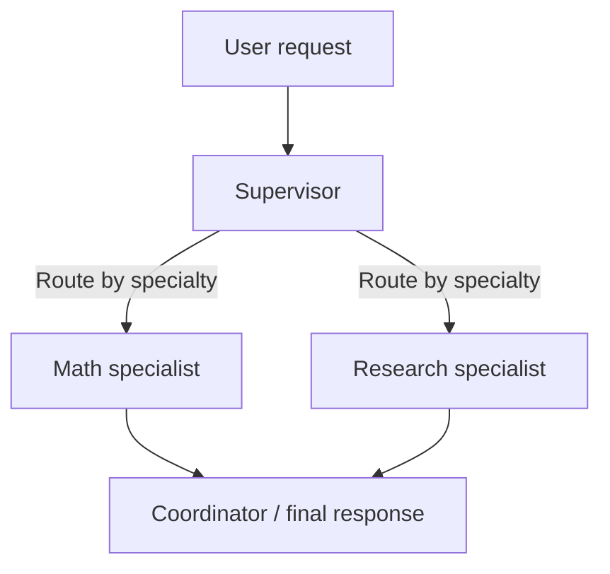
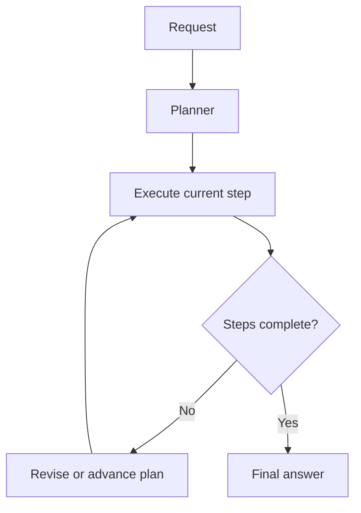
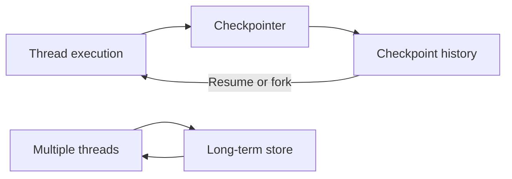

# Week 6: Agent Design Patterns — Questions and Answers

This week compares multi-agent coordination and plan-and-execute designs, then examines LangGraph persistence, checkpoint history, durability, and tasks.

## Technical Questions

1. **How can a supervisor route work to specialist agents in a graph?**  
   Store a routing decision in shared state and use conditional edges to invoke the selected specialist.

2. **How can you make a specialist agent callable by a coordinator?**  
   Wrap its invocation in a typed tool function and return the specialist’s result to the coordinator.

3. **How can agents collaborate sequentially on a task?**  
   Have one agent write results to shared state and pass those results to the next agent as its input.

4. **What state fields are useful in a plan-and-execute workflow?**  
   Track the original request, planned steps, completed results, current step index, and final response.

5. **How can the planner provide steps in a machine-readable form?**  
   Instruct it to return a JSON list of atomic steps, parse and validate that list, and store it in graph state.

6. **How can a graph repeatedly execute plan steps and then finalize?**  
   Route from the executor back to itself while steps remain; route to the finalizer once the plan is complete.

7. **How can a LangGraph run save snapshots of its state?**  
   Compile with a checkpointer and invoke the graph with a `thread_id`.

8. **How can you inspect a thread’s saved execution history?**  
   Call `graph.get_state_history(config)` using the same thread configuration.

9. **How can you resume from a specific checkpoint?**  
   Use the checkpoint’s ID together with the thread ID in the configurable portion of the graph configuration, then invoke from that checkpoint.

10. **How can you branch execution from an earlier checkpoint?**  
    Call `graph.update_state` with the checkpoint configuration and desired state edits, then invoke using the returned fork configuration.

11. **How do in-memory, SQLite, and PostgreSQL checkpointers differ?**  
    Memory is suitable for demos and is process-local; SQLite stores locally in a file; PostgreSQL supports durable, concurrent deployments.

12. **How do `exit`, `async`, and `sync` durability modes differ?**  
    `exit` persists at termination or interruption, `async` saves in the background, and `sync` saves before the next step proceeds.

13. **How does the Functional API `@task` decorator help during replay?**  
    It records side-effectful or nondeterministic work so a replay can reuse the saved result instead of repeating the operation.

14. **What does an `@entrypoint` provide in the Functional API example?**  
    It defines the workflow entry point and can associate a checkpointer with the function-style workflow.

15. **What should a plan executor do when a step fails or invalidates later steps?**  
    Record the outcome and revise the remaining plan before continuing, rather than blindly executing obsolete steps.

## Conceptual Questions

1. **When is a supervisor-and-specialist design appropriate?**  
   Use it when tasks can be routed to agents with distinct roles, capabilities, or tool sets.

2. **What is the advantage of sequential agent handoff?**  
   It lets each stage specialize in one job and pass an explicit result to the next stage.

3. **Why should each specialist have a focused responsibility?**  
   Focused roles clarify boundaries, tool access, and expected outputs, making coordination easier to understand.

4. **How does plan-and-execute differ from ReAct?**  
   Plan-and-execute creates an explicit multi-step plan before carrying it out; ReAct alternates reasoning and action one step at a time.

5. **When is plan-and-execute useful?**  
   It is useful for multi-step tasks where the plan should be inspected, tracked, or revised as results arrive.

6. **Why keep the original request alongside the plan?**  
   It gives later stages the goal needed to interpret step results and produce a relevant final answer.

7. **What is a checkpoint?**  
   A checkpoint is a saved snapshot of graph state at a point in the execution.

8. **What does a checkpointer provide beyond conversation memory?**  
   It can preserve workflow progress for recovery, inspection, resumption, or branching—not just prior chat messages.

9. **How do a checkpointer and a long-term store differ?**  
   A checkpointer tracks state for a thread; a store can hold information for reuse across threads or workflows.

10. **What is time-travel debugging in a graph workflow?**  
    It means inspecting earlier checkpoints and replaying or branching execution from a selected state.

11. **Why might a workflow fork from a checkpoint instead of editing the original history?**  
    A fork explores a changed state while preserving the original execution path for comparison and audit.

12. **What tradeoff does synchronous durability make?**  
    It offers stronger persistence before each next step but can add latency.

13. **Why is in-memory checkpointing unsuitable for durable production state?**  
    Its data disappears when the process ends and is not shared across independent workers.

14. **Why wrap API calls or writes in tasks when replay is possible?**  
    Repeating a side effect can cause duplicate work; a saved task result can make replay safer.

15. **How should plans and task outputs be handled when they may be malformed or incomplete?**  
    Validate them, surface failures, and allow the workflow to revise or stop rather than treating invalid data as success.

## Supervisor and Plan-and-Execute Patterns

## Persistence Scope

